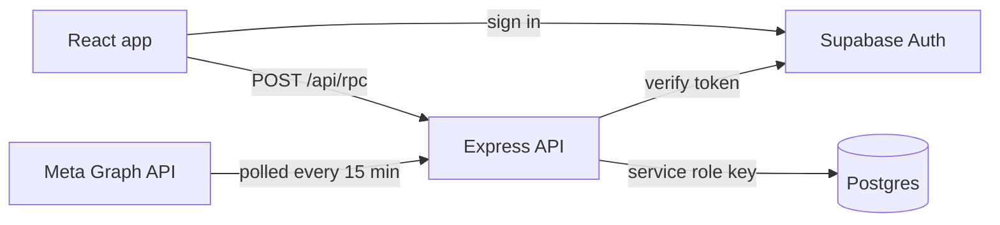

# Leadwise

A lead management CRM for sales and telecalling teams. Leads arrive from Facebook and Instagram ads and from Excel sheets, the owner hands them out, and each caller calls, follows up and closes their own.

> **This is a demo with fake data.** Leadwise is a public copy of an internal CRM I built for a real company. Every person, phone number, project, campaign and deal amount here is made up by the seed script. No company data is in this repo. The Meta lead sync is the real code, but it is not connected in the demo.

## The problem

A sales or telecalling team running ads gets dozens of leads a day. Leads that are not called quickly go cold. When two people end up calling the same customer, it looks bad. And at the end of the month the owner wants to know who closed what, and from which campaign.

## What I built

I built the frontend, the API, the database schema, the Meta lead sync and the seed data.

* **Leads.** Mine, Unassigned and All views. Filter by status, priority (hot, warm, cold), source, campaign, repeat enquiries, month or a custom date range. Edit, assign, reassign or bulk assign. Each lead has one person handling it.
* **Fair distribution.** The owner splits the day's unassigned leads evenly across chosen people in one click, or sets a custom count per person.
* **Status rules.** There are 9 statuses, from New to Investment Done/Closed. A lost lead needs a reason, a closed lead needs the deal amount, and closed or lost leads are locked.
* **Follow ups.** Grouped into overdue, today and upcoming, so call backs don't get missed.
* **Calls.** Calling a lead from the app logs the call.
* **Works on a bad connection.** Status changes and calls are saved in the browser first and sent in the background, retrying until the server confirms. Each change carries an id, so a retry never saves it twice.
* **Performance.** Each person's leads, calls, closed deals and conversion by source and campaign, with charts. The owner also gets a Team performance page comparing everyone.
* **Add lead.** Add one lead by hand, upload an Excel sheet (finds the name and phone columns by itself and rejects rows without a valid 10 digit number), or download any filtered set of leads as Excel.
* **Owner tools.** Users (invite, deactivate, hand someone's leads to another person), and campaigns with lead counts and lead quality.
* **Sign in.** Email and password or Google. Only people the owner added on the Users page can get in.

## Keeping costs low with Google Sheets

The real company wanted to keep running costs close to zero, so in the real project Google Sheets is the database. To keep it secure, the sheet is never shared or exposed to the browser. Everything goes through an API (Apps Script) that checks who is asking, reads the sheet, does all the processing and sends back only what that person is allowed to see. Nobody can open the sheet or read another caller's leads, even if they know where the data lives. For another client, I built the same idea with n8n workflows on top of Google Sheets.

A spreadsheet is a slow database, and the first builds lagged on every page load. I fixed that in two ways:

* **Processing on the backend.** Filtering, history and totals are worked out on the server, so the browser gets a small, finished result instead of the raw sheet.
* **Caching.** The app saves the last lead list in the browser and shows it instantly on the next visit, then refreshes it quietly in the background. Pages open fast and don't flicker while data loads.

This public demo keeps the same frontend and the same caching, with Express and Postgres on Supabase standing in for the sheet.

## Results

* **One list for every lead.** Meta ads and Excel uploads land in the same place, so nobody copies leads across from Meta by hand.
* **No duplicate work.** A phone number that is already in the CRM becomes a "repeat enquiry" on the original lead, so two callers never chase the same person.
* **A full history.** Every assignment, status change and call is logged with who did it, when, the old and new value, and the reason.
* **Numbers the owner can trust.** A deal can't be closed without an amount or lost without a reason, so the performance and campaign figures come from complete data.
* **Privacy between callers.** Employees only see their own leads and the unassigned leads. The server enforces this, not just the UI.

## Architecture

The React app signs in with Supabase Auth. Every read and write goes to one endpoint, `POST /api/rpc`, as `{ action, args, token }`. The Express API checks the token, loads the user, applies the visibility rules and only then touches Postgres. The CRM tables have row level security turned on with no policies, so the browser can't read or write them directly. Only the API can, using the service role key.

**Stack:** React 19, TypeScript, TanStack Query, Tailwind CSS, Vite, Express 5, Supabase (Postgres and Auth). The API runs TypeScript directly on Node 22.18+, so there is no build step on the server.

### Endpoints

| Endpoint | What it does |
| --- | --- |
| `GET /api/health` | Checks the database and returns its latency. Answers 503 if the database is down, so a host can use it as a health check. |
| `POST /api/rpc` | Runs one action: `{ action, args, token }` in, `{ ok: true, data }` or `{ ok: false, error }` out. |

The actions behind `/api/rpc`:

* **Reads:** `currentSession`, `listLeads`, `performance`, `callStats`, `listUsers`, `listCampaigns`, `listSources`
* **Leads:** `writeLead` (update one lead, or assign one or many), `logCall`, `addLead`, `importLeads`
* **Owner only:** `createUser`, `updateUser`, `deleteUser`, `setMetaConnected`

### How requests are handled

* **Who is asking.** The Supabase token is verified on every call, then the user is loaded from the `users` table. A deactivated user is treated as signed out straight away, even if their token is still valid.
* **What they can see.** An employee only gets their own leads and the unassigned leads, and can only take an unassigned lead for themselves. Owner only actions refuse anyone else with "Only the owner can do that."
* **Errors people can read.** Every expected failure comes back as `{ ok: false, error }` with a plain sentence, such as "That lead no longer exists." The app shows that sentence to the user as is. If the session has expired, the app signs the user out and sends them to the login page.
* **Bad requests.** Broken JSON gets a 400, a body over 5 MB gets a 413, an unknown path gets a 404. An unexpected crash is logged on the server, and the user only sees a generic "try again" message, never a stack trace.
* **Imports in batches.** An Excel upload is capped at 5000 rows and written 500 at a time. Duplicate phone numbers are checked in chunks of 200, so one big file never turns into one giant query.
* **CORS.** Only origins listed in `ALLOWED_ORIGINS` can call the API. Requests are sent as `text/plain` JSON, which counts as a simple request, so the browser skips the extra preflight round trip on every call.

## The hard part: getting leads out of Meta

Most of the app is ordinary CRUD done carefully. The Meta lead ads sync ([`backend/src/services/meta.ts`](backend/src/services/meta.ts)) is where things got tricky.

**Access comes before code.** A normal token can't read lead form data. It needs a Page access token with the `leads_retrieval` permission, which means going through Meta App Review and business verification before it works on a real page. Even after that, a token can stop working, so the sync has to be ready for that.

**Polling instead of webhooks.** Meta can send a webhook for each new lead, but the webhook only carries a lead ID, so you still have to call back for the details. Instead, the API polls every 15 minutes. It asks each lead form only for leads created after the last one it saw. This is simpler to run and picks up anything that came in while the server was down.

**Meta's data is messy.** Some examples:
* Dates come back as `2026-10-29T08:41:12+0000`. JavaScript doesn't reliably parse that offset, so it gets rewritten to `+00:00` first.
* Different forms name their fields differently, for example `full_name` or `name`, and `phone_number` or `phone`.
* The platform comes back as `ig` for Instagram.

**The same person shows up more than once.** People fill in a form twice, or answer ads for two projects. Each Meta lead ID is stored in a unique column, so a lead is never imported twice. Phone numbers are normalised, and a number that already exists is added to the original lead as a "repeat enquiry". Callers see that the customer came back instead of getting a second copy.

**Old campaigns keep sending leads.** A lead form doesn't care whether the campaign behind it is still running. With an ad account configured, the sync checks which campaigns are active, which uses a separate ads token, and skips the rest. A campaign flagged as stopped in the database is skipped too.

**Failures are visible.** If a sync fails, for example because a token expired or Meta returned an error, the message is saved and shown on the Campaigns page. The owner sees it without anyone reading server logs. A simple guard also makes sure two syncs never run at the same time.

## Tradeoffs

Every choice here fits a team of a few people with thousands of leads, not millions. Here is what I gave up, and what I'd change if the app grew.

* **One RPC endpoint instead of REST.** The real project runs on Apps Script, which gives you a single URL. Keeping the same `{ action, args }` contract let this demo swap in a different backend without rewriting the frontend. The cost: no per route HTTP caching, and errors come back with HTTP 200, so standard monitoring won't flag them as failures.
* **Access rules in the API, not in Postgres.** All visibility rules live in one TypeScript file, which is easy to read and test. Row level security is only used to lock the browser out. The cost: a bug in the API is not caught by the database. With more roles, I'd move the rules into row level security policies.
* **Filtering in Node, not SQL.** `listLeads` loads the leads and their history, then filters them in the API. It's simple and fast at this size. With hundreds of thousands of leads, I'd move the filters into SQL and paginate.
* **Arrays instead of join tables.** Lead assignees are a `uuid[]` column. Reading it is easy. The cost: no foreign keys, so deleting a user has to remove their ID from every lead by hand, which the API does.
* **Polling Meta instead of webhooks.** Leads can take up to 15 minutes to appear, and there's no public webhook endpoint to verify and secure. For faster leads, I'd add webhooks and keep the polling as a safety net.
* **An in-process lock for the sync.** It stops two syncs from running at once, but only inside one server. With more than one API server, I'd use a Postgres advisory lock.
* **No build step on the server.** Node runs the TypeScript directly, so deploys are just `npm start`. The cost: it needs Node 22.18 or newer, and can't use TypeScript features that need compiling, such as enums.

## What I'd do next

* **Call duration tracking.** Right now a call is logged when someone taps Call, but the app can't tell a 5 second miss from a 10 minute conversation. Recording how long each call lasted would make the call stats and team performance much more honest.
* **Bulk WhatsApp messages.** Callers often send the same details or follow up message to many leads by hand. Selecting leads and sending one WhatsApp message to all of them through the WhatsApp Business API would save that time and log each message on the lead.
* **Tests.** The lead rules (status changes, transfers, follow ups, priority, performance) are plain functions in `frontend/src/logic/rules/`, so they are the obvious place to start. There are no automated tests yet.
